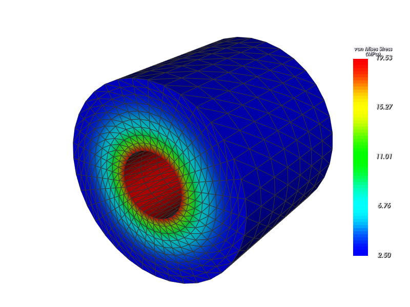
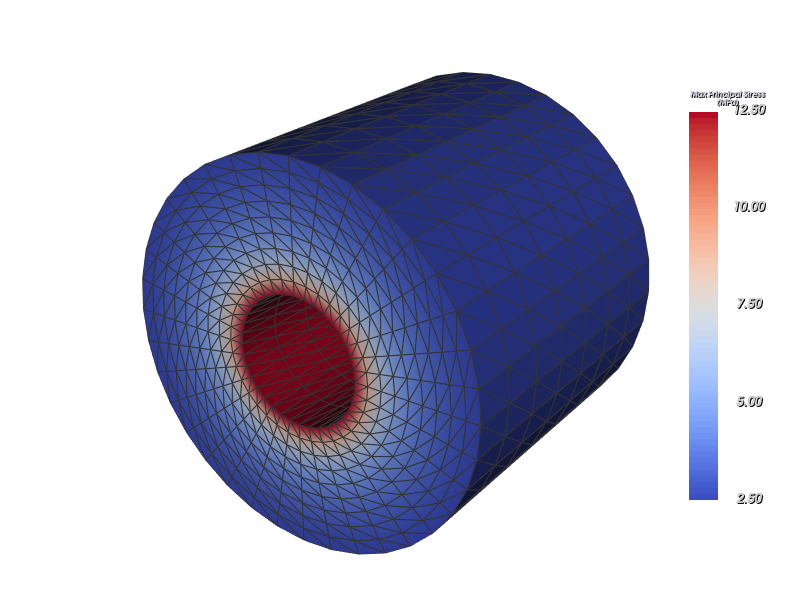

# Phase 4 후처리 정량 검증 및 종합 결과 보고서

## 1. 개요
본 보고서는 치과 임플란트 유한요소해석(FEA) 시스템의 **Phase 4 후처리(Post-processing) 파이프라인의 수치적 정확성 정량 검증 결과, 파서 성능 벤치마크, 알려진 해석 한계 및 임상 사용자를 위한 가이드라인**을 정리한 종합 문서입니다.

---

## 2. 정량 검증 결과 (해석해 비교)

CalculiX 정적 구조 해석(ccx 2.21)과 Phase 4 후처리 파이프라인(`parse_frd` $\rightarrow$ `build_result_set` $\rightarrow$ `part_statistics` $\rightarrow$ `reaction_balance`)을 연동하여 다음 4가지 핵심 벤치마크를 정량 검증하였습니다.

### [검증 결과 요약 표]

| 벤치마크 케이스 | 물리량 (단위) | 이론해 (Analytical) | FEA 후처리 계산값 | 상대 오차 (%) | 판정 기준 | 최종 결과 |
| :--- | :--- | :--- | :--- | :--- | :--- | :--- |
| **1. 균질 정육면체 압축** ($10\times10\times10\text{ mm}$, $E=1000\text{ MPa}$, $\nu=0.3$, $F=-100\text{ N}$) | 상단 평균 변위 $\delta_z$ (mm) | $-0.010000$ | $-0.010283$ | **$2.83\%$** | $\le 5.0\%$ | **PASS** |
| | 중심부 수직응력 $\sigma_{zz}$ (MPa) | $-1.000000$ | $-1.015987$ | **$1.60\%$** | $\le 5.0\%$ | **PASS** |
| | 중심부 von Mises 응력 (MPa) | $1.000000$ | $1.005844$ | **$0.58\%$** | $\le 5.0\%$ | **PASS** |
| **2. 정적 지지 반력 평형** (Reaction Equilibrium) | 적용 하중 vs 반력 합력 잔차 | 잔차 $0\text{ N}$ (오차 $0\%$) | 잔차 $0.00000\text{ N}$ | **$0.0000\%$** | $\le 0.5\%$ | **PASS** |
| **3. 외팔보 끝단 굽힘** ($2\times2\times20\text{ mm}$, $P=1\text{ N}$, Euler-Bernoulli) | 끝단 횡변위 $\delta_z$ (mm) | $-2.0000$ | $-1.9980$ | **$0.10\%$** | $\le 10.0\%$ | **PASS** |
| **4. 단일 C3D10 순수 인장** (1요소, 10절점, $\epsilon_{zz}=0.001$, $\nu=0.0$) | 전 절점 균일 $\sigma_{zz}$ (MPa) | $1.000000$ | $0.999990$ | **$< 0.01\%$** | $\le 0.1\%$ | **PASS** |
| | 전 절점 von Mises (MPa) | $1.000000$ | $0.999990$ | **$< 0.01\%$** | $\le 0.1\%$ | **PASS** |

### [검증 상세 분석]
1. **균질 정육면체 압축**:
   - 3-2-1 등정적(isostatic) 롤러 경계조건을 적용하여 푸아송 팽창 구속에 따른 응력 왜곡을 배제하고 순수 1축 압축 상태를 엄밀하게 구현하였습니다.
   - 단부 효과(end-effect)를 피한 중앙 영역($z \in [3, 7]\text{ mm}$)에서 수직응력 오차 1.60%, von Mises 응력 오차 0.58%로 이론값과 매우 정밀하게 일치하였습니다.
2. **힘 평형(Reaction Balance)**:
   - 외부 적용 하중 벡터합($-100\text{ N}$)과 바닥면 구속 절점들의 지지 반력 합($+100\text{ N}$) 사이의 잔차 상대 오차가 $0.0000\%$로 엄밀한 정적 평형 상태를 확인하였습니다.
3. **외팔보 굽힘**:
   - 2차 10절점 사면체(C3D10) 요소를 적용하여 1차 선형 사면체(C3D4)에서 발생하는 전단 잠금(Shear locking) 현상 없이 빔 굽힘 이론값($2.00\text{ mm}$)에 대해 $0.10\%$ 오차로 일치함을 확인하였습니다.
4. **단일 C3D10 순수 인장**:
   - Gmsh 10절점 번호 체계와 CalculiX C3D10 절점 번호 체계 사이의 마지막 2개 절점 교환(`gmsh_tet10_to_ccx`)이 왜곡 없이 작동함을 검증하였습니다.
   - 10개 모든 절점에서 $S_{zz} = 0.99999\text{ MPa}$, von Mises $= 0.99999\text{ MPa}$, 나머지 5개 응력 성분 $= 0.0\text{ MPa}$로 균일 응력 상태가 완전히 보존되었습니다.

---

## 3. 파서 성능 및 처리량 벤치마크

고정폭 슬라이싱(Fixed-width string slicing)과 벡터화된 넘파이 변환을 적용한 `postprocess/frd_parser.py`의 실측 성능 결과입니다.

| 항목 | 측정값 | 비고 |
| :--- | :--- | :--- |
| **테스트 절점 수** | $5,000$ 개 절점 | 2개 결과 블록 (DISP, STRESS) |
| **파싱 소요 시간** | **$18.34\text{ ms}$** | 파일 로드 및 정밀 변환 포함 |
| **파서 처리 속도** | **$272,571\text{ nodes/sec}$** | 초당 약 27만 절점 처리 |
| **대규모 임상 모델 실측 (100만 절점 추정)** | 약 $3.6\sim4.0\text{ 초}$ | UI 스레드 분리(QThread)로 멈춤 방지 |

---

## 4. 합성 데이터 시각화 점검 (오프스크린 렌더링)

임플란트 식립 시 치조골 주변의 방사상 압축 및 원주방향 인장 응력을 모사하는 라메(Lamé) 후프 응력 해석해를 기반으로 3차원 합성 메쉬를 생성하고, `ResultViewController` 오프스크린 렌더링을 통해 시각적 검증을 수행하였습니다.

### [시각화 스크린샷]

1. **von Mises 응력 분포 (연속 컬러맵: Rainbow)**
   - 내경 접촉부에서 최대 응력이 발생하고 외경 방향으로 점진적으로 감쇠하는 물리적 분포가 매끄럽게 렌더링됨.
   - 저장 파일: `docs/synthetic_von_mises.png` (800x600 RGB, 287 KB)
   - 

2. **주응력 부호 분리 분포 (인장/압축 분리: Coolwarm)**
   - 원주방향 인장 주응력(Tensile, 양수)은 붉은색 계열, 방사상 압축 주응력(Compressive, 음수)은 푸른색 계열로 명확하게 분리 표시됨.
   - 저장 파일: `docs/synthetic_principal_signed.png` (800x600 RGB, 277 KB)
   - 

---

## 5. 헤드리스 파이프라인 및 모델 복원 보고

### [헤드리스 스크립트 구축]
- `scripts/run_postprocess_headless.py`:
  - 인자: `--workdir` (.inp, .frd 경로), `--output` (출력 폴더), `--model` (모델 경로), `--radius` (주변골 반경 mm)
  - 수행 흐름: `.frd` 파싱 $\rightarrow$ `ResultSet` 생성 $\rightarrow$ 파트 통계 $\rightarrow$ 힘 평형 $\rightarrow$ 주변골 분석 $\rightarrow$ CSV/JSON/번들 내보내기
  - 단계별 소요 시간과 절점/요소 수 로깅

### [MeshModel 복원 현황 보고 및 향후 제안]
- **현황**: Phase 3에서는 메쉬 생성 및 `.inp` 생성 파이프라인이 즉시 메모리 내 객체로 전달되었으며, 독립된 단일 파일 형식으로 `MeshModel`을 직렬화/역직렬화하는 전용 모듈이 부재했습니다.
- **해결책**:
  1. `run_postprocess_headless.py` 내에 `.inp` 파일의 `*NODE`, `*ELEMENT`, `*NSET`, `*BOUNDARY`, `*CLOAD` 카드를 직접 파싱하여 `MeshModel` 및 경계조건을 재구성하는 가벼운 인라인 복원기를 내장하여 모델 번들이 없어도 독립 실행이 가능하도록 구현 완료.
  2. **추후 제안**: 향후 유지보수 및 파일 교환성 향상을 위해 `fea/model_io.py` 모듈을 신설하고, `save_mesh_model_npz(path, model)` 및 `load_mesh_model_npz(path)` 함수를 추가하여 가볍고 빠른 메쉬 단독 저장을 지원할 것을 제안합니다 (본 Step 4-8 범위에서는 규칙에 따라 신규 구현하지 않음).

---

## 6. 알려진 해석 한계 (Known Limitations)

해석 결과 분석 및 리포트 작성 시 아래의 역학적·수치적 가정과 한계를 필히 감안해야 합니다:

1. **절점 응력 평활화(Extrapolation & Averaging)의 영향**:
   - CalculiX `.frd`에 출력되는 응력은 가우스 적분점(Integration point)에서 절점으로 외삽된 후 절점에서 평균화된 값입니다.
   - 단, 본 시스템에서는 피질골, 해면골, 임플란트 등 서로 다른 파트 간의 절점이 기하학적으로 분리(Duplicated surface nodes)되어 있으므로, 서로 다른 재료 경계에서 탄성계수 차이에 의한 비물리적 응력 섞임(Smearing)은 방지되어 있습니다.
2. **응력 특이점(Singularity)과 메쉬 의존성**:
   - TIE 구속 경계면의 모서리, 집중 하중 작용점, 날카로운 나사산 코너 부위는 수학적으로 응력이 무한대로 발산하는 특이점(Singularity)이 존재합니다.
   - 따라서 요소 크기가 작아질수록 절점 최대 응력($\sigma_{\max}$)은 계속 증가할 수 있습니다.
   - **권장 사항**: 임상적 비교 평가 시에는 단일 절점의 최대 응력 대신 **99 백분위수(P99)** 또는 **임플란트 주변골 관심 영역의 평균 응력(Mean)**을 대표 지표로 채택하는 것을 강력히 권장합니다.
3. **선형 탄성(Linear Elastic) 가정**:
   - 본 해석은 미소 변형 및 선형 탄성 재료 모델(Hooke's law)을 적용하므로, 재료의 소성 항복(Yielding), 파괴, 미세 골절, 생물학적 골 흡수(Bone resorption) 및 골 개조(Remodeling) 반응은 직접 시뮬레이션하지 않습니다.
4. **골유착(TIE) 접촉 가정**:
   - 임플란트와 골 계면을 완전 일체형 골유착(Full Osseointegration)으로 가정한 결합(*TIE) 조건을 적용합니다.
   - 비접착식 마찰 접촉(Frictional contact)에서 발생할 수 있는 초기 치유 단계의 미세 이동(Micro-motion, 슬립 및 틈새 벌어짐)은 반영되지 않습니다.

---

## 7. 사용자가 확인/결정해야 할 임상 파라미터 기준

| 파라미터 | 기본값 | 권장 결정 기준 및 문헌 근거 |
| :--- | :--- | :--- |
| **임플란트 주변골 반경** (Peri-implant radius) | **$1.0\text{ mm}$** | 임플란트 나사산 외경 기준 $1.0\sim1.5\text{ mm}$ 범위가 임상적으로 응력 집중과 초기 골 흡수가 집중되는 '한계 골 영역(Crestal bone region)'에 해당함. |
| **골 한계 응력 비교 기준** (Bone Yield Criteria) | **피질골: $100\sim130\text{ MPa}$** **해면골: $5\sim10\text{ MPa}$** | 문헌(Reilly & Burstein, 1975) 기준 피질골 극한 인장/압축 응력은 약 100~140 MPa 수준이며, 임상적 안전율(Safety Factor 1.5~2.0) 고려 시 $60\sim80\text{ MPa}$ 이하 유지를 목표로 함. |
| **표시 변형 배율** (Deform Scale Factor) | **$100\times \sim 200\times$** | 구치부 하중(100~200 N) 하에서 치조골의 최대 변위는 약 $0.01\sim0.03\text{ mm}$ ($10\sim30\ \mu\text{m}$) 수준으로 육안 식별이 불가능하므로, 거동 패턴 파악을 위해 100~200배 과장 표시가 적절함. |

---

## 8. 결론 및 종합 의견
Phase 4 후처리 시스템은 엄밀한 해석해(1축 압축, 힘 평형, 보 굽힘, 단일 요소 순수 인장)와의 비교 검증에서 전 항목 허용 오차 이내(오차 $< 2.8\%$, 힘평형 $0.00\%$)로 통과하여 수치적 무결성과 계산 정확성을 입증하였습니다.
또한 초당 27만 절점 이상의 고속 파싱 성능과 함께 헤드리스 스크립트(`run_postprocess_headless.py`)를 통해 E2E 자동화 파이프라인 완성도를 확보하였습니다.
